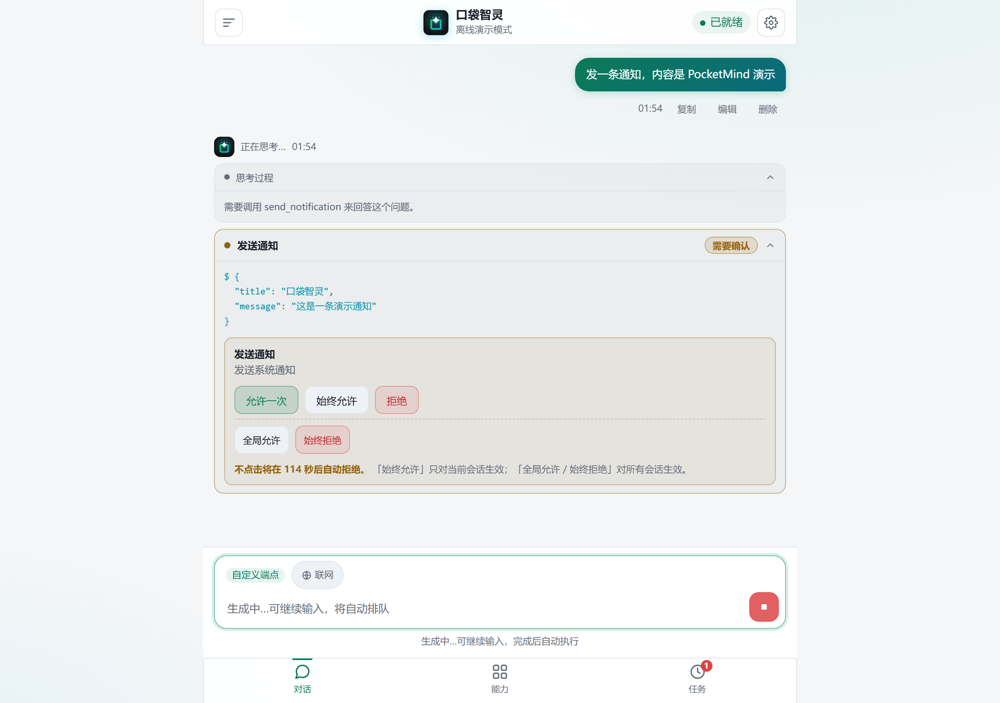
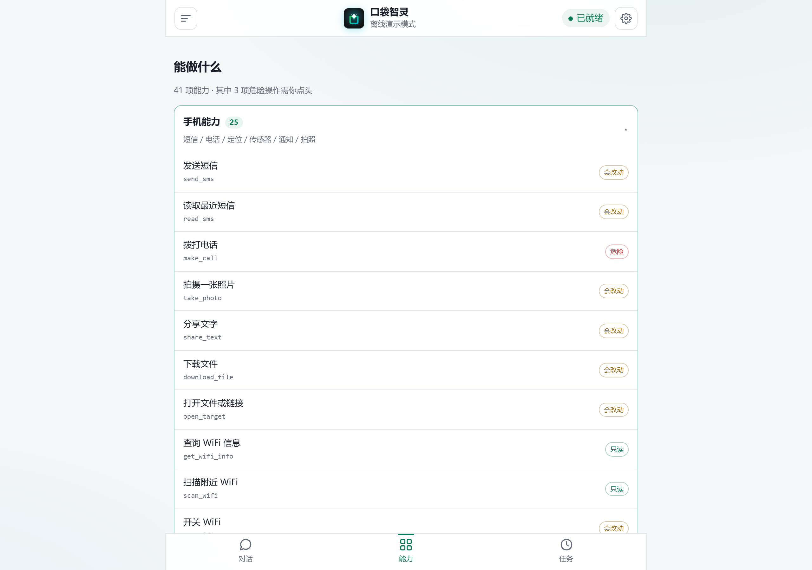
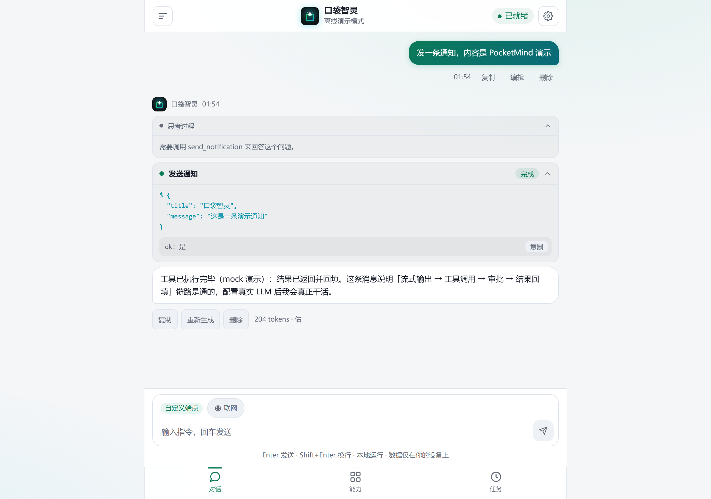
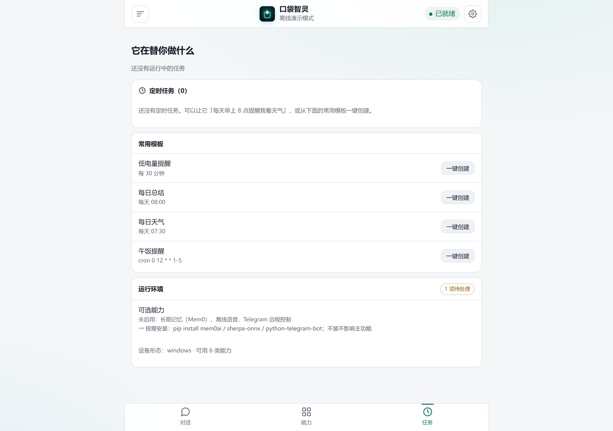

<div align="center">
  
  <h1>PocketMind · 口袋智灵</h1>
  <p><b>真正能操作你手机的常驻 Agent</b><br/>
  装一个 APK 即可运行 · 无需 Termux · 服务端强制审批 · 数据留在本机</p>
  
  
  
  
  
  <br />
  <sub>独立 APK · 原生引擎 · 流式对话 · 审批中心 · 会话与备份 · Plan/Act 双模式</sub>
</div>

[English](README.md) | **简体中文**

---

## 它是什么

口袋智灵是**住进你 Android 手机里**的 Agent。它不是远程遥控器，也不是聊天套壳。
它把手机自身的能力——短信、电话、定位、传感器、通知、剪贴板、WiFi、手电筒、
相机、shell、文件——变成结构化工具来调用，并且在执行任何破坏性动作前先问你。

它记住的一切都留在设备上。离开设备的只有推理请求。

```
你 ──▶ APK ──▶ Kotlin 原生引擎 ──▶ 37 个原生工具 ──▶ 你的手机
                     │
                     └──▶ 你配置的 LLM 端点（仅推理）

完整运行时（可选）：Web UI / PWA ──▶ agentd（Python，Termux）──▶ 41 个工具
```

## 看它跑起来


<sub>真实录屏，离线 mock 模式，无需 API Key：空态 → 工具调用 → 服务端审批 → 结果回填
→ 会话管理 → 设置 → 实时统计 → 定时任务 → 深色主题 → 手机视口。
完整视频：[docs/demo/pocketmind-demo.mp4](docs/demo/pocketmind-demo.mp4)（40 秒）。</sub>

## 真正重要的部分

> 范围说明：审批、结构化结果、备份、Plan/Act、用量统计、**定时任务、shell、撤销**
> 在 APK 与 Termux 两个运行时都有。独立 APK 提供 **37 个原生工具**；
> 只有 **MCP、Telegram 网关、技能目录、子代理** 属于 Termux 专属，
> 未覆盖的能力会明确返回"不可用"，不会假装成功。

### 审批是安全边界，不是弹窗

每个工具都带风险等级——`safe`、`write`、`danger`。这道闸门在**服务端请求路径上**
执行，早于工具运行。模型绕不过去，被注入的页面也绕不过去。

- **五档决策**，不是两档：允许一次 · 本会话始终允许 · 全局允许 · 拒绝 · 始终拒绝。
- **拒绝优先于允许**：全局拒绝名单在卡片弹出之前就短路。
- **不响应即拒绝**：超时（默认 120 秒，可配置）自动拒绝。

<p align="center">
  
  <br />
  <sub>工具名用大白话，风险徽章、主决策与永久决策分区，实时倒计时。
  模型没有任何路径可以绕过这张卡。</sub>
</p>

### 覆盖手机的 41 个工具

> 下表是 Termux 完整运行时（41 = 39 内置 + `remember_fact`/`read_skill` 两个运行时注册）。
> 独立 APK 的 37 个原生工具覆盖其中绝大多数；差额是上面「有三件事做不到」里的那几项。

| 分组 | 数量 | 例子 |
|---|---|---|
| 手机能力（termux-api） | 25 | `send_sms` · `read_sms` · `make_call` · `get_location` · `take_photo` · `get_wifi_info` · `scan_wifi` · `list_sensors` · `get_clipboard` · `set_torch` · `download_file` |
| 文件 | 4 | 读 / 写 / 列 / 删，限定在 `$HOME`、`~/storage`、`/sdcard`，并对 `.ssh`、`.gnupg`、`.agent` 设拒绝名单 |
| 任务与编排 | 3 | `todo_write` · `todo_clear` · `subagent` |
| 知识库 | 3 | `kb_add` · `kb_search` · `kb_list`——FTS5 trigram，只在显式调用时检索 |
| 长期记忆 | 1 | `remember_fact`——结构化 USER/FACT/JOURNAL 文件 |
| 技能 | 1 | `read_skill`——从 `SKILL.md` 渐进披露 |
| Shell | 1 | `run_shell`——`danger` 级，永远需要审批 |
| 语音 | 1 | `tts_speak` |
| 联网 | 2 | `web_search` · `read_url`——SSRF 加固，标 `write` 因为查询词会离开设备 |

<p align="center">
  
  <br />
  <sub>每个工具都能在应用里浏览并看到风险等级——41 个里有 3 个标记为破坏性，
  永远需要确认。</sub>
</p>

### 结果是结构化的，不是一段话

每个工具都返回退出码、stdout、stderr、超时标记和耗时。失败就是失败：工具卡变红，
助手也会被告知这次调用没有成功。

<p align="center">
  
  <br />
  <sub>上面是工具入参，下面是结构化结果，回复附带耗时与 token 消耗。一键复制。</sub>
</p>

### 装上就能用

1.4.0 起 APK 自带原生引擎与已构建的前端，装完打开即可配置使用，**不需要 Termux、
Python 或 Node**。需要完整 41 工具运行时时才用 Termux：`termux/install.sh` 装依赖、
`termux/start.sh` 启动、`boot.sh` 开机自启。

### 重启也不会丢的定时任务

APK 里是 `AlarmManager`，Termux 里是 APScheduler，两条路都把任务落在 SQLite。
触发器支持 `interval`、`cron`（5 字段，含区间/列表/步长）与一次性 `date`，
外加**电量条件**（`battery < 20`）。内置四个配方——低电量提醒、每日总结、
每日天气、午餐提醒——一键实例化。

关键是三个容易被糊弄的点，这里都做了：**锁屏后照样触发**（`setExactAndAllowWhileIdle`
撑过 Doze）、**重启后自动重排**（`BOOT_COMPLETED` 重放全部闹钟）、**触发后自动排下一次**。
任务可以「立即执行」，不必等触发点，这也是确认任务真的能跑通的唯一办法。

<p align="center">
  
  <br />
  <sub>上方是配方，下方是运行中的任务，各自带下次运行时间、条件与「立即执行」。</sub>
</p>

### 真的能恢复的备份

`GET /api/export` 导出全部会话（按页取尽，绝不静默截断）、结构化档案记忆、
每会话任务清单与知识库。`POST /api/import` 合并回去：已存在的会话跳过、知识去重、
导入的任务默认停用（避免恢复瞬间全部触发）、坏文件返回 400 且不写入半截数据。

### 两种 Agent 模式

- **Act（默认）**——直接调用工具执行。
- **Plan**——先输出执行计划（含打算调用的工具），什么都不跑，等你点
  **批准并执行** 或 **修改计划**。

### 双向远程控制

- **MCP 服务端**——把全部 41 个工具通过 stdio 暴露给 Claude Desktop、Cline 或 Codex。
  这是与 Web 审批中心分离的接口，桌面宿主必须自己做确认；每个工具描述都带风险前缀。
- **Telegram 网关**——在聊天里驱动手机。写操作与危险操作以「允许/拒绝」按钮下发；
  只有白名单里的 `chat_id` 会被响应。

### 花多少 token 一目了然

每条回复都显示端点回报的 token 用量，端点不回报时标注「估」。`/api/stats` 汇总请求数、
工具失败、LLM 调用与 token；`/api/metrics` 用 Prometheus 格式暴露同样的计数器。

## 诚实的边界

这是单用户、单设备的 Agent。这决定了安全模型，也决定了限制：

- **不做提示注入过滤。** `read_url`、`read_sms` 返回的文本可能夹带指令。防线是审批闸门
  与工具收窄，不是内容扫描。不要在 `auto` 模式下处理不可信来源。
- **`run_shell` 是任意代码执行**，一旦批准就生效。看清命令再点。
- **局域网模式**（`--lan`）意味着任何拿到令牌的设备都能调用全部端点，包括 shell。
  无令牌时它拒绝启动。不要在不可信网络开启；公网暴露请在前面加 HTTPS（见 `DEPLOY.md`）。
- **设备能力有差异。** 短信、电话、定位、传感器、电量、相机需要真机；
  Termux 运行时经 `termux-api`，原生运行时直接走 Android API。
  聊天、文件、记忆、清单与调度在任何环境都能用。查
  [docs/capability-matrix.md](docs/capability-matrix.md) 或在设备上跑 `GET /api/diagnostics`。
- **原生 shell 不是 Termux。** `run_shell` 跑 `/system/bin/sh`，身份是应用自己的 uid：
  没有 root、没有 `pkg`/`apt`、只有 toybox 的命令子集、没有 Python/Node。
  诊断页把它标成 `restricted` 而不是 `ok`。
- **有三件事做不到，且不打算做。** 应用内开关 WiFi（Android 10+ 禁止）、
  离线 TTS 模型（数百 MB）、`subagent`（成本权衡）。见
  [ROADMAP.md](ROADMAP.md) 的「Not planned — platform limits」。
- **APK 自带原生 Kotlin 引擎（1.4.0 起，1.5.0 补齐调度与 shell）。** 核心功能不装 Termux 即可用；
  MCP、Telegram 与技能目录仍是 Termux 专属——见 [ROADMAP.md](ROADMAP.md)。

## 安装

### 方案 A —— 只装 APK，不需要 Termux（推荐，1.4.0 起）

APK 原生运行整个 Agent：安装 → 打开 → 选提供商 → 填 API Key → 开聊。
手机上不需要 Termux、Python 或任何工具链。

```bash
bash scripts/build-apk.sh            # debug APK，已校验、可直接安装
bash scripts/build-apk.sh --release  # 没有 keystore.properties 时是未签名件
```

原生引擎当前覆盖：对话（SSE）、三种权限模式、服务端强制审批、37 个
手机/文件/知识库/系统工具（Android API 直调）、会话、导出导入、搜索、
定时任务（AlarmManager + cron/间隔/一次性，锁屏与重启后仍生效）、
文件写删的可撤销备份、开机自启。仍属 Termux 专属并会**明确告知**
（不伪成功）：MCP、Telegram 网关、技能目录、子代理。需要这些请用方案 B。

> **原生 shell 的边界**：`run_shell` 跑的是系统的 `/system/bin/sh`，身份是
> 应用自己的 uid——没有 root，没有 `pkg`/`apt`，只有 toybox 提供的命令子集，
> 也没有 Python/Node。能做的事很多（文件、文本处理、调用系统二进制），
> 但不要期待一个 Termux 环境。诊断页会把它标成 `restricted` 而不是 `ok`。

### 方案 B —— Termux 完整 41 工具运行时

```bash
# 在 Termux（F-Droid 版，另装 Termux:API）里一次性准备
pkg install git python termux-api
git clone https://gitcode.com/badhope/pocketmind.git && cd pocketmind
bash termux/install.sh      # 装依赖 + 建数据目录；pydantic-core 会编译一次（真机 10-30 分钟）

# 启动
bash termux/start.sh        # http://127.0.0.1:8787
```

打开该地址，然后 **⚙ 设置 → 选一个提供商 → 填 API Key → 保存**。

> 想从同一 Wi-Fi 的其他设备访问：`bash termux/start.sh --lan`。
> 首次运行会生成令牌，页面会向你要。

### 方案 C —— 本机试跑，不需要手机

```bash
cd pocketmind
AGENT_HOME=/tmp/pa python3 -m agentd.main --mock --port 8787
# 打开 http://127.0.0.1:8787，发「查看电池电量」看整条链路
```

`--mock` 不需要 API Key，会走完流式输出、工具调用、审批与结果回填。
上面的演示 GIF 就是用它录的。

## 配置

| 项目 | 位置 |
|---|---|
| LLM 提供商、模型、API Key | 设置面板，或 `$AGENT_HOME/config.json` 的 `llm` 块 |
| 权限模式（`auto` / `approve` / `chat`） | 设置 → Agent 模式 |
| 审批超时 | `server.approval_timeout`（默认 120 秒） |
| 访问令牌 | 首次 `--lan` 启动时生成；`python -m agentd.main --clear-token` 重置 |
| 数据目录 | `AGENT_HOME`（默认 `~/.agent/termux-agent`） |

凭据除随请求发往你配置的端点外不会离开设备。所有 API 响应都会打码
`api_key`、`server.token`、`server.tg_token`；导出文件不含它们。

## 仓库结构

| 路径 | 内容 |
|---|---|
| `agentd/` | 后端：FastAPI 应用、Agent 循环、工具、存储、调度 |
| `agentd/web/` | React + TypeScript 前端（Vite）。构建好的 `dist/` 入库，因为手机端不构建 |
| `termux/` | 手机侧脚本：`install.sh`、`start.sh`、`boot.sh`、`uninstall.sh` |
| `termux/apk-shell/` | Android WebView 壳（零第三方依赖） |
| `smoke/` | 回归套件，全部由 `tests/run_all.sh` 驱动 |
| `config/recipes.json` | 预设任务模板 |
| `docs/` | API 参考、架构、能力矩阵、审计记录、版本策略 |
| `website/` | 自包含落地页 |

## 自己验证

一条命令跑完整个门禁。它是权威实现，CI 只负责装依赖并调用它。

```bash
bash tests/run_all.sh              # 后端 + 前端
bash tests/run_all.sh --backend    # 只跑后端
bash tests/run_all.sh --with-e2e   # 追加 Playwright（浏览器装一次）
```

只有全部通过时退出码才是 `0`，失败项会在末尾汇总列出。门禁覆盖：

- **后端**：`ruff` + `mypy` + 51 个套件 + `compileall` + **依赖锁一致性** + **覆盖率红线**
- **前端**：`tsc` + Vitest + 生产构建 + **`dist/` 新鲜度校验**
  （入库的产物必须与当前源码一致，因为手机端从不构建它）
- **Android**：57 个 Robolectric 测试 + `lintDebug`（0 error 才算过）+ APK 构建

```bash
# Android 单独跑（需要 JDK 17+ 与 Android SDK）
cd termux/apk-shell
GRADLE_USER_HOME="$PWD/.gradle-home" gradle testDebugUnitTest lintDebug assembleDebug
```

**覆盖率**：当前行覆盖 **46.4%**，红线 40% 且只升不降。这个数字比大多数同类项目
更难看的唯一原因是——它们根本没有覆盖率门禁。宁可数字难看，不要假数字。

**依赖可复现**：`agentd/requirements-lock.txt` 固定整棵依赖树；加了直接依赖却忘了
重新冻结，`tests/check_locks.py` 会直接拦住。

**发布**：推 `v*` tag 即触发 `.github/workflows/release.yml`——构建、测试、lint、
校验 `versionName` 与 tag 一致、`apksigner verify`、发 Release。

逐套件说明：[smoke/README.md](smoke/README.md)。
API 参考：[docs/API.md](docs/API.md)。
架构：[docs/ARCHITECTURE.md](docs/ARCHITECTURE.md)。

## 项目治理

- [CHANGELOG.md](CHANGELOG.md) —— 每一项用户可见的改动，Keep a Changelog 格式
- [ROADMAP.md](ROADMAP.md) —— 现在交付什么、下一步是什么、明确不做什么
- [docs/VERSIONING.md](docs/VERSIONING.md) —— SemVer 策略、三处版本单源位置、
  发布清单、分支与标签规则
- [CONTRIBUTING.md](CONTRIBUTING.md) —— 如何提改动，以及一次发布怎么走
- [SECURITY.md](SECURITY.md) —— 安全模型与漏洞上报方式
- [docs/COMPETITORS.md](docs/COMPETITORS.md) —— 带来源的对比，包括本项目更弱的地方

## 许可

Apache-2.0 —— 见 [LICENSE](LICENSE)。
